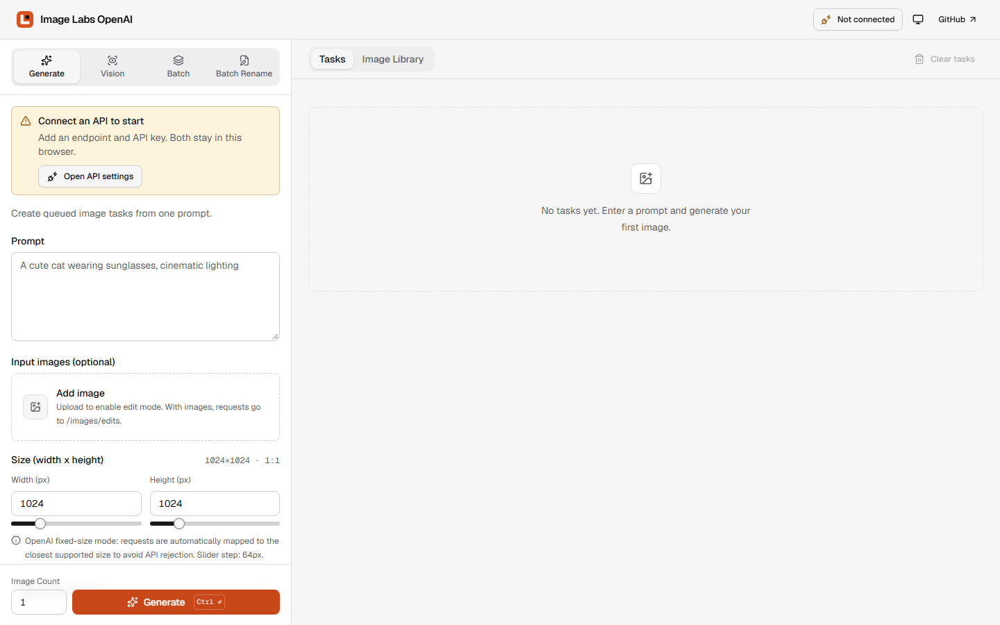

<div align="center">


# Image Labs OpenAI

**A browser-only studio for OpenAI-compatible image APIs.**
Generate, edit, analyse and batch-process images with your own API key. No backend, no account, nothing leaves your browser except the request you send.

[](./LICENSE)
[](https://react.dev)
[](https://vite.dev)
[](https://www.typescriptlang.org)
[](https://ui.shadcn.com)

[Features](#features) ·
[Quick start](#quick-start) ·
[Configuration](#configuration) ·
[How it works](#how-it-works) ·
[Security](#security) ·
[Contributing](#contributing)

<br />

<picture>
  <source media="(prefers-color-scheme: dark)" srcset="docs/assets/screenshot-dark.png" />
  
</picture>

</div>

## Features

| Workspace | What it does |
| --- | --- |
| **Generate** | Text-to-image and image edits, with reference images, a painted or uploaded inpainting mask, model-aware size presets, and an Advanced JSON field for any parameter the UI does not expose. |
| **Vision** | Upload images and ask a multimodal model to describe them, explain them, or extract their text. |
| **Batch** | Run a list of prompts (one per line or pasted CSV) against shared reference images, track progress, retry failures, and export the whole batch as a ZIP. |
| **Batch Rename** | Let a vision model name image files from their content, then download a ZIP or a Windows `.bat` pair to apply or undo the renames. |

Across every workspace:

- **Bring your own key and endpoint.** Works with the official OpenAI API or any OpenAI-compatible relay.
- **Model picker** with current OpenAI image and vision models, your endpoint's live list via `GET /models`, or any custom model id.
- **Parallel queue** with a configurable concurrency limit, cancel and retry per task.
- **Image library** stored in IndexedDB: virtualised grid, marquee selection, ZIP export, reuse params, edit from any result.
- **Per-task cost estimate** from OpenAI list prices (a rough reference; relays differ) and a full request/response debug view.
- **Accessible by default:** keyboard reachable everywhere, labelled controls, visible focus, reduced-motion support, light and dark themes.
- **Installable** as a PWA.

## Quick start

Requires Node.js 20 or newer.

```bash
git clone https://github.com/kaizenics/image-labs-openai.git
cd image-labs-openai
npm install
npm run dev
```

Open the printed local URL, click **Not connected** in the top bar, and add your API base URL and key. Then write a prompt and press <kbd>Ctrl</kbd> / <kbd>⌘</kbd> + <kbd>Enter</kbd>.

### Scripts

| Command | Description |
| --- | --- |
| `npm run dev` | Start the Vite dev server |
| `npm run build` | Type-check and build to `dist/` |
| `npm run preview` | Serve the production build locally |
| `npm run deploy` | Build and publish `dist/` to GitHub Pages |

The repo also ships a GitHub Actions workflow (`.github/workflows`) that deploys to GitHub Pages on every push to `main`.

## Configuration

Everything is configured in the app under **API settings** and saved to your browser's `localStorage`.

| Setting | Default | Notes |
| --- | --- | --- |
| API base URL | `https://api.openai.com/v1` (OpenAI preset) | Any OpenAI-compatible endpoint |
| API key | none | Stored only in this browser |
| Image model | `gpt-image-1.5` | Also `gpt-image-2`, `gpt-image-1`, `gpt-image-1-mini`, or custom |
| Vision model | `gpt-4.1-mini` | Any multimodal model that accepts images on `/responses` |
| Response format | `url` | Or `b64_json` |
| Concurrency | `3` | 1 to 10 parallel requests |

Optional build-time defaults can be set in a `.env` file (see [`.env.example`](./.env.example)):

```bash
VITE_DEFAULT_MODEL=gpt-image-1.5
VITE_DEFAULT_VISION_MODEL=gpt-4.1-mini
```

> [!WARNING]
> Never put an API key in `.env`. Vite inlines every `VITE_*` variable into the public JavaScript bundle.

## How it works

The app calls the REST endpoints directly with `fetch`:

```txt
POST {baseUrl}/images/generations   text to image (JSON)
POST {baseUrl}/images/edits         image(s) + prompt to image (multipart/form-data)
POST {baseUrl}/responses            image(s) + prompt to text (JSON)
GET  {baseUrl}/models               optional, for the model picker
```

<details>
<summary>Example request and response</summary>

```json
{
  "model": "gpt-image-1.5",
  "prompt": "A cute cat wearing sunglasses",
  "n": 1,
  "size": "1024x1024",
  "response_format": "url"
}
```

Both response shapes are supported:

```json
{ "data": [{ "url": "https://example.com/image.png" }] }
```

```json
{ "data": [{ "b64_json": "..." }] }
```

Edit requests send the same fields as `multipart/form-data` with one or more `image` parts and an optional `mask`. Vision requests send `input_text` plus base64 `input_image` items to `/responses`.

</details>

<details>
<summary>Why direct fetch instead of the OpenAI SDK?</summary>

The official JavaScript SDK only runs in browsers with `dangerouslyAllowBrowser: true`, because browser use can expose credentials. This project is a deliberate bring-your-own-key frontend, so a small `fetch` wrapper keeps the bundle smaller, avoids SDK browser warnings, and works with any custom base URL.

</details>

For every Images API parameter you can pass through Advanced JSON, see [`docs/api-features.md`](./docs/api-features.md).

## Security

- Your API key is stored in your browser's `localStorage` and sent only to the endpoint you configure. This project has no server and never proxies or collects it.
- Anyone with access to the browser profile can read the key. Do not use the app on shared or public devices.
- Do not commit API keys, and do not put them in `.env` files.

### CORS

Because requests go straight from the browser, the API provider must allow CORS. If a request works in curl or Postman but fails here with `Failed to fetch`, CORS is the likely cause.

## Tech stack

[React 18](https://react.dev) · [TypeScript](https://www.typescriptlang.org) · [Vite](https://vite.dev) · [Tailwind CSS](https://tailwindcss.com) · [shadcn/ui](https://ui.shadcn.com) on [Radix](https://www.radix-ui.com) · [lucide](https://lucide.dev) icons · [Geist](https://vercel.com/font) · [i18next](https://www.i18next.com) for UI strings · [JSZip](https://stuk.github.io/jszip/) · [sonner](https://sonner.emilkowal.ski)

```txt
src/
  api/          OpenAI-compatible request builders (images, vision, models)
  components/   app components; ui/ holds the shadcn primitives
  hooks/        task queue, settings, local storage
  lib/          sizing rules, pricing, image cache, exports, helpers
  i18n/         UI strings
```

## Contributing

Issues and pull requests are welcome.

1. Fork the repo and create a branch from `main`.
2. Run `npm run build` before opening a PR; it type-checks the whole project.
3. Keep UI changes on the existing design tokens (`src/index.css`) and shadcn components in `src/components/ui`.

## License

[MIT](./LICENSE)
